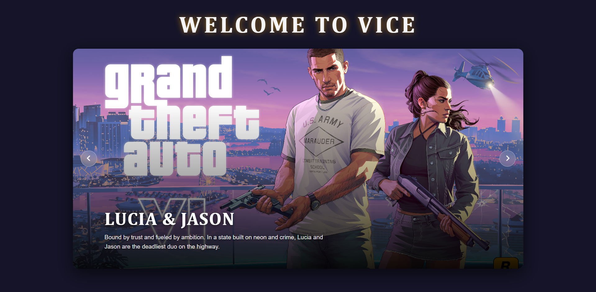
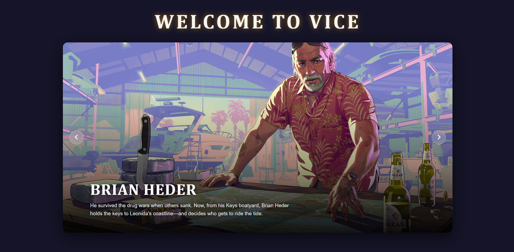
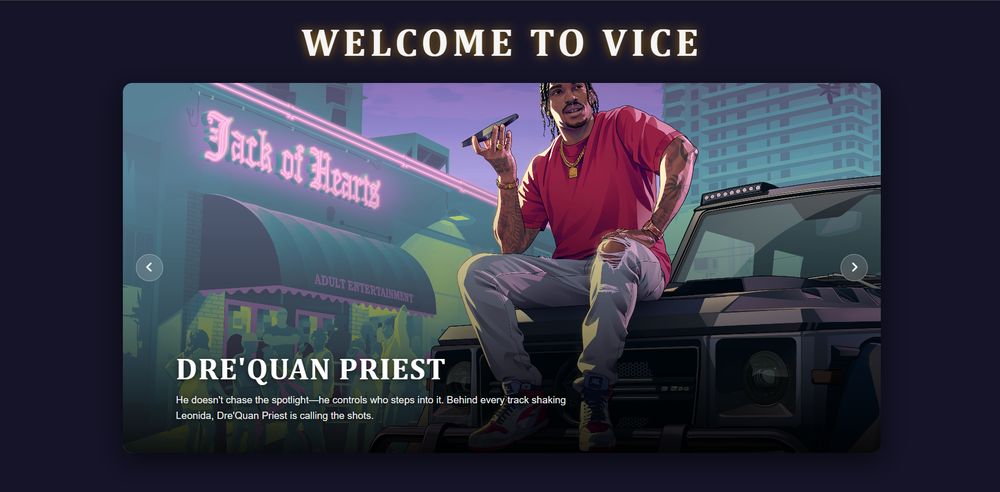
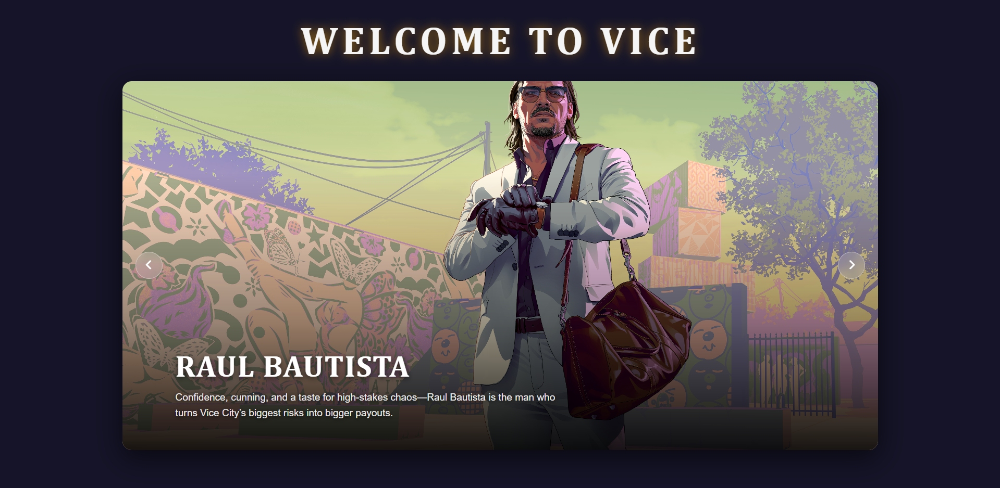

<div align="center">

# 🌴 WELCOME TO VICE

### A GTA VI Inspired Interactive Image Slider

An interactive character showcase inspired by the world of Grand Theft Auto VI.

[🎬 View Project Demo](https://github.com/user-attachments/assets/433b8082-bdd7-457c-b3bf-5e26a4b96566)

</div>

---

## 📌 About The Project

**Welcome to Vice** is a JavaScript-based image slider inspired by Rockstar Games' Grand Theft Auto VI.

The project showcases characters through a cinematic image slider with smooth transitions, descriptive captions, and automatic slide navigation.

It was built using **HTML, CSS, and Vanilla JavaScript**, focusing on DOM manipulation, event handling, arrays, objects, and timing functions.

## 🖼️ Character Gallery

The slider features characters and promotional artwork inspired by GTA VI.

<div align="center">

| Jason & Lucia | Brian Heder |
|:---:|:---:|
|  |  |

| Dre'Quan Priest | Raul Bautista |
|:---:|:---:|
|  |  |

</div>

## ✨ Features

- **Automatic Slideshow:** Automatically changes slides every 3 seconds.
- **Next & Previous Navigation:** Move between slides using navigation buttons.
- **Continuous Navigation:** Automatically returns to the first slide after the last slide and vice versa.
- **Hover to Pause:** Automatically pauses the slideshow when the mouse enters the slider.
- **Automatic Resume:** Restarts the slideshow when the mouse leaves the slider.
- **Smooth Animations:** Uses CSS animations for image transitions.
- **Dynamic Content:** Updates images, titles, and descriptions using JavaScript.

## 🛠️ Technologies Used

| Technology | Purpose |
|---|---|
| HTML5 | Project structure |
| CSS3 | Styling, layout and animations |
| JavaScript | Slider functionality and DOM manipulation |
| Font Awesome | Navigation icons |

## 📂 Project Structure

```text
project-slider/
│
├── css/
│   ├── all.min.css
│   └── slider.css
│
├── js/
│   └── slider.js
│
├── outputs/
│   ├── brian.png
│   ├── dre-quan.png
│   ├── Jason&Lucia.png
│   ├── project-demo.mp4
│   └── raul-bautista.png
│
├── webfonts/
│   ├── fa-brands-400.woff2
│   ├── fa-regular-400.woff2
│   ├── fa-solid-900.woff2
│   └── fa-v4compatibility.woff2
│
└── slider.html
```

## ⚙️ How It Works

The slider uses a JavaScript array of objects to store the image URLs, titles, and descriptions for each slide.

A `currentIndex` variable keeps track of the currently displayed slide.

JavaScript functions handle:

- Displaying the current slide.
- Moving to the next and previous slides.
- Automatically changing slides using `setInterval()`.
- Pausing and restarting autoplay using mouse events.
- Updating HTML elements dynamically through DOM manipulation.

CSS animations provide smooth visual transitions between images.

## 🚀 Getting Started

### 1. Clone the Repository

```bash
git clone https://github.com/Husen77k/PROJECT_JS_SLIDER.git
```

### 2. Open the Project

Navigate to the project folder:

```bash
cd PROJECT_JS_SLIDER
```

### 3. Run the Project

Open `slider.html` in your browser.

You can also use the **Live Server** extension in Visual Studio Code for a better development experience.

## 🎯 Learning Objectives

This project helped me practise and understand:

- JavaScript arrays and objects.
- DOM selection and manipulation.
- Event listeners and event handling.
- Functions and conditional statements.
- `setInterval()` and `clearInterval()`.
- Dynamic content rendering.
- CSS animations and transitions.
- Connecting HTML, CSS, and JavaScript.

## 👨‍💻 Author

**Husen**

Computer Engineering Student | JavaScript Learner

GitHub: [@Husen77k](https://github.com/Husen77k)

---

## ⚠️ Disclaimer

This is an unofficial fan-made project created for educational and practice purposes.

Grand Theft Auto VI and its related characters, artwork, and trademarks belong to **Rockstar Games** and **Take-Two Interactive**.

This project is not affiliated with, endorsed by, or associated with Rockstar Games.

---
